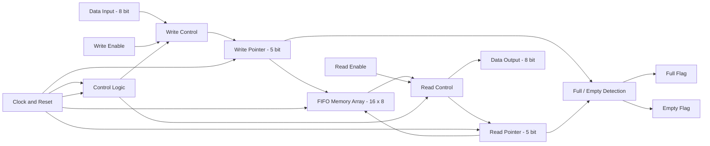

# FIFO Controller — Block Diagram

## 1. Top-Level Architecture

The diagram illustrates the primary functional blocks of the synchronous FIFO memory controller.

## 2. Functional Summary

- The write control receives input data and write requests.
- The write pointer identifies the memory location used for writing.
- The memory array stores the data.
- The read pointer identifies the next data location to be read.
- The read control manages valid read requests.
- The status logic generates full and empty conditions.
- Clock and reset synchronize the controller.

## 3. Design Notes

This diagram represents the planned logical architecture. The detailed RTL may combine or separate some logic blocks based on implementation requirements.

**Status:** Initial architecture diagram  
**Revision:** 1.0
